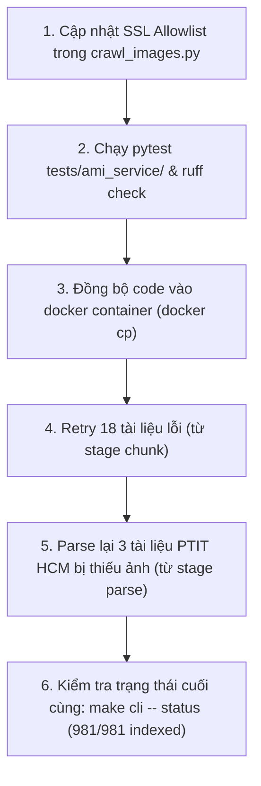

# Kế hoạch Thực thi: Xử lý SSL Allowlist và Hoàn tất Reindex Toàn bộ Tài liệu Lỗi

## 1. Kết quả Kiểm tra Thực tế (Probe Test) sau khi cấp thêm VRAM ở Máy B

Sau khi vLLM máy B được cấu hình thêm VRAM và hỗ trợ đa định dạng ảnh (AVIF, SVG, RGB -> PNG):

| Phép thử nghiệm | Kết quả | Thời gian phản hồi | Đánh giá |
|---|---|---|---|
| **Health Check (`GET /health`)** | **HTTP 200** | 0.03s | Server sống, cả `embed` và `rerank` đều `true` |
| **Embed Text đơn thuần** | **HTTP 200 (dim=2048)** | 0.23s | Bình thường, nhanh |
| **Embed PNG Image** | **HTTP 200 (dim=2048)** | **1.84s** | **ĐÃ HẾT TIMEOUT** (trước đây bị ReadTimeout do cold start lần đầu) |
| **Embed Batch (3 items gồm text + ảnh)** | **HTTP 200 (vectors=3)** | 0.04s | Batching và VRAM hoạt động rất mượt |
| **Test Document AVIF (`6a4d1fcf44e99bb8b2f2aca1`)** | **OK: `indexed` (chunks=5)** | ~2.5s | **Thành công 100%** (trước đây fail 400) |
| **Test Document SVG (`6a4d20cb44e99bb8b2f2af99`)** | **OK: `indexed` (chunks=9)** | ~3.1s | **Thành công 100%** (trước đây fail 400) |
| **Test Document Socket Drop (`6a4d207344e99bb8b2f2ae8f`)** | **OK: `indexed` (chunks=5)** | ~2.2s | **Thành công 100%** |
| **Tải thử ảnh `ptithcm.edu.vn` (`verify=False`)** | **HTTP 200 (335,635 bytes)** | 0.8s | Đã tải được ảnh mà trước đó bị lỗi SSL |

> **Kết luận:** Gateway vLLM máy B đã hoạt động hoàn toàn ổn định sau khi được cấp thêm VRAM. Lỗi Timeout ban đầu chính xác là do cold start lần đầu sau khi restart service. Toàn bộ định dạng AVIF, SVG và các ảnh raster đều được gateway xử lý trực tiếp sang PNG trơn tru.

---

## 2. Thống nhất Quyết định

1. **Chuẩn hóa ảnh ở máy A:** **BỎ HOÀN TOÀN**. Không can thiệp decode/convert AVIF/SVG ở máy A để tránh decode/convert 2 lần gây tốn CPU và suy giảm chất lượng ảnh.
2. **SSL Allowlist cho 2 domain PTIT:** Thêm allowlist tin cậy cho `ptit.edu.vn` và `ptithcm.edu.vn` vào `ami_rag/workers/crawl_images.py` để lấy được trọn vẹn ảnh cho các bài viết trực thuộc PTIT HCM.
3. **Phạm vi xử lý tài liệu:** **Chỉ xử lý các tài liệu lỗi/thiếu ảnh**:
   - 18 tài liệu `failed` (trước đó lỗi 400 do AVIF/SVG hoặc disconnect).
   - 3 tài liệu bị thiếu ảnh do lỗi SSL (`6a4d1fd244e99bb8b2f2acaa`, `6a88a3150cb67ed80c08f84f`, `6a908c1a0cb67ed80c08f859`).
   - Giữ nguyên toàn bộ các tài liệu đã `indexed` thành công trước đó (không reindex toàn bộ kho dữ liệu).
4. **Nhánh làm việc:** Tiếp tục triển khai trực tiếp trên nhánh hiện tại `feature/backend-data-parser`.

---

## 3. Các thay đổi Mã nguồn (Proposed Code Changes)

### Component: `ami_rag.workers.crawl_images`
#### [MODIFY] `ami_rag/workers/crawl_images.py`
- Bổ sung hằng số `_TRUSTED_NO_SSL_VERIFY_DOMAINS = ("ptit.edu.vn", "ptithcm.edu.vn")`.
- Cập nhật hàm `_download(self, url: str)`:
  - Kiểm tra host qua `urlparse(url).hostname`.
  - Nếu thuộc domain tin cậy và là `https`, thiết lập client với `verify=False`.
  - Bổ sung cơ chế xử lý redirect an toàn (chỉ giữ `verify=False` nếu host redirect vẫn nằm trong domain tin cậy).

### Component: Test Suite
#### [MODIFY] `tests/ami_service/test_crawl_images.py`
- Bổ sung unit test cho tính năng SSL allowlist:
  - Khớp domain `ptit.edu.vn` và `ptithcm.edu.vn` -> chọn `verify=False`.
  - Không khớp domain ngoài (hoặc subdomain giả mạo) -> giữ `verify=True`.

---

## 4. Kế hoạch Thực thi (Execution Steps)



1. **Bước 1**: Sửa `ami_rag/workers/crawl_images.py` (thêm SSL allowlist cho 2 domain PTIT).
2. **Bước 2**: Chạy kiểm thử tự động `uv run pytest -q tests/ami_service/` và linting `uv run ruff check ami_rag tests/ami_service`.
3. **Bước 3**: Đồng bộ file đã sửa vào container `ami-rag-worker` và `ami-rag-api`.
4. **Bước 4**: Chạy retry hoàn tất cho 18 tài liệu lỗi:
   ```bash
   make cli -- retry --all-failed --yes
   ```
5. **Bước 5**: Chạy reindex lại cho 3 tài liệu PTIT HCM từ stage `parse` để tải bổ sung các ảnh vừa giải phóng SSL:
   ```bash
   make cli -- reindex --doc 6a4d1fd244e99bb8b2f2acaa 6a88a3150cb67ed80c08f84f 6a908c1a0cb67ed80c08f859 --from-stage parse --yes
   ```
6. **Bước 6**: Kiểm tra tổng kết trạng thái toàn hệ thống qua `make cli -- status` (kỳ vọng: `indexed: 981`, `failed: 0`).
